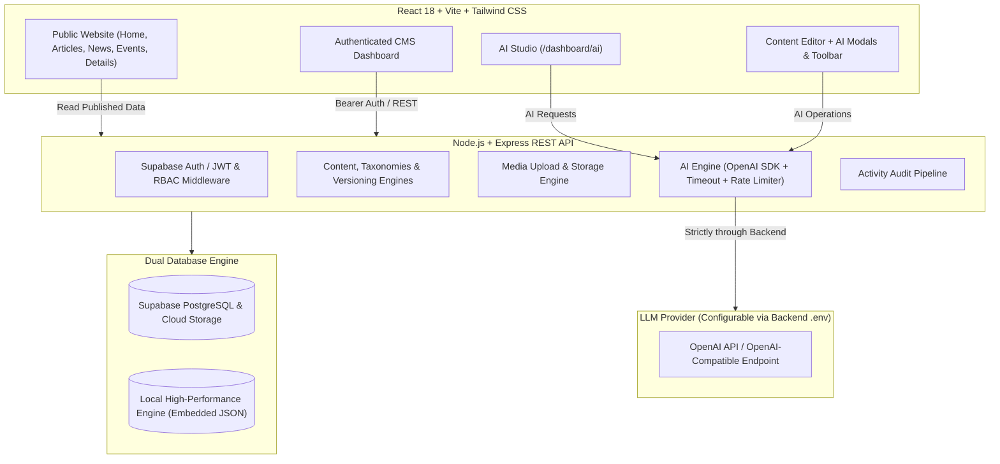

# ContentPilot AI — Full-Stack Content Management System

ContentPilot AI is an enterprise-grade Content Management System engineered in two phases:
1. **Phase 1: Complete Traditional CMS** — A full-stack, secure, standalone CMS and public publishing platform with role-based access control, publishing workflows, media library, content versioning, and zero AI dependency.
2. **Phase 2: AI Integration** — An optional, non-destructive editorial AI copilot integrating an AI Content Generator, Writing Assistant, SEO Assistant, Summarizer, Content Reviewer, and an AI Studio.

> [!IMPORTANT]
> **AI AVAILABILITY & ISOLATION GUARANTEE**: AI is completely optional and isolated. If the AI provider is disconnected, out of credits, or unconfigured, the application gracefully displays:
> *"AI Assistant is currently unavailable. You can continue managing your content manually."*
> **All CMS features** (login, drafting, review workflow, publishing, public website, media library, user management, and database operations) **continue operating at 100% capacity**.
> Furthermore, **AI never automatically publishes or overwrites content**; human authors, editors, and admins retain total control.

---

## Architecture Overview



### Technology Stack
- **Frontend**: React 18, Vite, JavaScript (ESM), Tailwind CSS, React Router DOM v6, Axios, Lucide React icons.
- **Backend**: Node.js, Express.js (v5), REST APIs, Multer media pipeline, BCrypt, JWT authentication, OpenAI SDK (`openai`).
- **Database & Services**: Supabase PostgreSQL, Supabase Authentication, Supabase Storage, Supabase Row-Level Security (RLS) policies.
- **Dual Data Engine**: Runs seamlessly against remote Supabase PostgreSQL, or via an embedded local high-performance JSON database engine with zero external setup needed for local development and CI testing.
- **AI Integration**: Backend-proxied OpenAI API / OpenAI-compatible endpoint with sliding-window rate limiting, 35s timeouts, and structured JSON parsing.

---

## Phase 2: AI Capabilities

ContentPilot AI includes five dedicated AI tools available both inside the Content Editor and in the standalone AI Studio (`/dashboard/ai`):

### 1. AI Content Generator
- **Inputs**: Topic, Content Type (`Article`, `News`, `Announcement`, `Event`), Target Audience, Writing Tone (`Professional`, `Informative`, `Friendly`, `Formal`, `Creative`), and Desired Length (`Short`, `Medium`, `Long`).
- **Outputs**: Title, Description, Introduction, Main Content (semantic HTML with `<h2>`, `<h3>`, `<p>`, `<ul>`, `<blockquote>`), and Conclusion.
- **Actions**: Generate, Regenerate, Insert into Editor, Discard.
- **Safety**: Generated content is inserted into the editor for human review and is **never published automatically**.

### 2. AI Writing Assistant
- **Integration**: Accessible directly in the rich text editor toolbar via the **AI Assistant** button (works on selected text or full document), as well as in the AI Studio.
- **Quick Transformations**:
  - Fix grammar & spelling
  - Improve sentence flow & vocabulary
  - Rewrite with fresh phrasing
  - Simplify language
  - Make professional & executive
  - Shorten / condense
  - Expand with depth & context
  - Change writing tone
- **Safety**: Presents an original vs. improved side-by-side comparison modal with change notes. Requires explicit **Accept & Apply** confirmation; never overwrites without consent.

### 3. AI SEO Assistant
- **Integration**: Integrated directly into the SEO section of the Content Editor and available in the AI Studio.
- **Outputs**:
  - SEO Title (50-60 characters, front-loaded keywords)
  - Meta Description (140-160 characters with high CTR hook)
  - Suggested Keywords (array and comma-separated string)
  - 3-5 concrete on-page optimization recommendations
- **Actions**: Individual **Apply** buttons allow users to cherry-pick which suggestions to adopt into form fields.

### 4. AI Summarizer
- **Inputs**: Long-form articles, news stories, announcements, or custom text.
- **Outputs**:
  - One-line executive hook
  - Concise summary paragraph
  - Bulleted key takeaways
- **Actions**: One-click clipboard copy for each section, and an **"Apply as Article Excerpt"** button.

### 5. AI Content Reviewer
- **Purpose**: An editorial advisory diagnostic tool that inspects drafts before submission.
- **Analyzes**:
  - Overall quality score (1-100)
  - Grammar and typographical issues
  - Sentence clarity and readability
  - Missing information or context gaps
  - Redundancy and repetitive phrasing
  - Content safety & tone appropriateness
  - Concrete editorial recommendations
- **Human Authority**: Purely advisory. AI cannot approve, reject, or publish content. Human Editors and Admins retain exclusive authority.

---

## Phase 1: Traditional CMS Foundations

Even without AI configured, ContentPilot AI is a complete, standalone publishing platform:

### 1. Public Website
- **Home**: Hero banner, search bar, category filter pills, featured article showcase, latest articles grid, announcements bulletin, upcoming events spotlight.
- **Articles & News**: Full-text search, category filtering, reading time estimates, author info, and sorting.
- **Announcements & Events**: Bulletins and event cards with dates, times, and venue details.
- **Article Details**: Full article rendering, tags, author bio, social sharing, and related article recommendations.
- **About Us & Contact**: Editorial principles, architecture overview, interactive contact form with instant validation, and FAQ accordion.
- **Data Integrity**: Public website strictly displays `status = 'published'` content.

### 2. Role-Based Access Control (RBAC) Matrix

| Capability | Administrator | Editor | Author | Public Reader |
| :--- | :---: | :---: | :---: | :---: |
| **Browse Published Content** | Yes | Yes | Yes | Yes |
| **Create New Drafts** | Yes | Yes | Yes | No |
| **Edit Own Drafts & Submissions** | Yes | Yes | Yes | No |
| **Edit Other Users' Content** | Yes | Yes | **Forbidden (403)** | No |
| **Submit Draft for Review** | Yes | Yes | Yes | No |
| **Publish Content Directly** | Yes | Yes | **Forbidden (400/403)** | No |
| **Approve / Reject Submissions** | Yes | Yes | **Forbidden (403)** | No |
| **Delete Published Content** | Yes | Yes | **Own drafts only** | No |
| **Manage Taxonomies / Categories** | Yes | Yes | No | View only |
| **Upload Media Library Assets** | Yes | Yes | Own uploads only | View only |
| **User Governance (Roles & Status)** | **Yes (Exclusive)** | No | No | No |
| **View Audit Activity Logs** | Yes | Yes | No | No |
| **Demote / Remove Last Admin** | **Blocked by Guard** | No | No | No |

### 3. Publishing Workflow
```
[Author creates draft] ──> [Save Draft] ──> [Submit for Review (status: pending_review)]
                                                         │
                                        ┌────────────────┴────────────────┐
                                        ▼                                 ▼
                              [Editor/Admin Approves]          [Editor/Admin Rejects]
                                        │                                 │
                                        ▼                                 ▼
                             (status: published)               (status: rejected)
                             Visible on public site            Author revises & re-submits
```

### 4. Content Versioning & Audit Logs
- Every title or body update creates a revision snapshot in `content_versions` with the editing user and timestamp.
- Full audit logging records logins, registrations, content changes, status changes, and user role updates in `activity_logs`.

---

## Pre-Configured Test Accounts

| Role | Email | Password | Privileges |
| :--- | :--- | :--- | :--- |
| **Administrator** | `admin@contentpilot.ai` | `Admin@123` | Complete CMS governance, user management, and publishing |
| **Editor** | `editor@contentpilot.ai` | `Editor@123` | Review queue, approving, rejecting, publishing, editing |
| **Author** | `author@contentpilot.ai` | `Author@123` | Draft creation, AI writing tools, review submission |

> [!TIP]
> The login screen at `/login` provides one-click quick-fill buttons for **Admin**, **Editor**, and **Author** credentials.

---

## Getting Started

### 1. Prerequisites
- Node.js version 18+ (tested on Node v24)
- npm version 9+

### 2. Installation
```bash
# Clone the repository and navigate into it
cd CMS

# Install root dependencies
npm install

# Install backend dependencies
cd backend && npm install && cd ..

# Install frontend dependencies
cd frontend && npm install && cd ..
```

### 3. Environment Configuration
Copy `.env.example` to `.env` (or configure `backend/.env`):
```bash
cp .env.example backend/.env
```

```env
PORT=5000
NODE_ENV=development
FRONTEND_URL=http://localhost:5173

# Optional Supabase Credentials (If omitted, uses local embedded storage engine)
SUPABASE_URL=
SUPABASE_ANON_KEY=
SUPABASE_SERVICE_ROLE_KEY=
JWT_SECRET=contentpilot-super-secret-jwt-key-2026-phase1

# Phase 2 AI Integration (Optional)
# If left empty, CMS continues in manual mode with a friendly availability notice
AI_API_KEY=
AI_MODEL=gpt-4o-mini
AI_PROVIDER=openai
# AI_BASE_URL=https://api.openai.com/v1   # Or custom proxy / local Ollama / Groq
```

### 4. Running the Application
```bash
npm run dev
```
- **Backend API**: `http://localhost:5000`
- **Frontend App**: `http://localhost:5173`
- **Health Check**: `http://localhost:5000/api/health`
- **AI Status**: `http://localhost:5000/api/ai/status`

---

## Running the Automated Test Suites

### Run Complete Test Suite (Phase 1 + Phase 2)
```bash
npm test
```

### Run Phase 1 Only (16 Traditional CMS Criteria)
```bash
npm run test:phase1
```

### Run Phase 2 Only (8 AI Integration & Graceful Fallback Criteria)
```bash
npm run test:phase2
```

### Build Frontend for Production
```bash
npm run build:frontend
```

---

## API Reference

### AI Endpoints (Phase 2)
All AI action endpoints require a Bearer token and enforce user rate limiting (30 reqs/min).
- `GET /api/ai/status` — Public endpoint reporting AI availability, provider, and model.
- `POST /api/ai/generate` — Generate draft content with semantic HTML structure.
- `POST /api/ai/improve` — Refine, fix grammar, rewrite, shorten, expand, or adjust tone.
- `POST /api/ai/seo` — Generate SEO title, meta description, keywords, and tips.
- `POST /api/ai/summarize` — Generate one-line, paragraph, and bulleted takeaways.
- `POST /api/ai/review` — Perform advisory editorial diagnostic review.

### Core CMS Endpoints (Phase 1)
- `GET /api/contents` — Public published content feed (supports filters & search).
- `GET /api/contents/slug/:slug` — Public article detail by slug.
- `GET /api/contents/manage` — Authenticated dashboard content list with status filters.
- `POST /api/contents` — Create new draft.
- `PUT /api/contents/:id` — Update draft or published article (records version snapshot).
- `DELETE /api/contents/:id` — Delete content.
- `POST /api/contents/:id/submit` — Submit draft for editorial review (`pending_review`).
- `POST /api/contents/:id/review` — Approve (`published`) or reject (`rejected`) submission.
- `GET /api/contents/:id/versions` — Retrieve revision history snapshots.
- `GET /api/categories` — Taxonomy list.
- `POST /api/media/upload` — Upload media asset.
- `GET /api/stats/dashboard` — Dynamic database statistics.
- `GET /api/users` & `PUT /api/users/:id/role` — Admin user governance.
- `GET /api/activity-logs` — Audit log trail.
